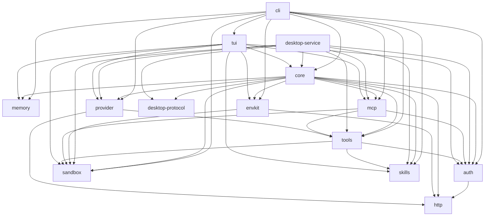

# アーキテクチャ

This is a generated file. Do not edit it by hand. `crates/polaris-core/tests/architecture.rs`が実際のsourceから作り直し、この文書と突き合わせる。ずれたら試験が落ちる。更新するには:

```
UPDATE_ARCHITECTURE=1 cargo test -p polaris-core --test architecture
```

この文書は2つを載せる。crateの依存関係と、外部との接続点である。要求の組み立て順は`docs/context-efficiency.md`、fileごとの一覧は`docs/filemap.md`にある。

## crateの依存



crate 14件、依存 47件。名前の`polaris-`は省いた。開発用の依存は、製品の組み立てを表さないため含めない。

## 外部との接続点

列挙するのは、外部へデータが出るか、processが動くか、利用者の木が変わる箇所である。試験とexampleは除く。境界そのものを実装しているfileは、呼び出し側を埋もれさせないため一度だけ名前を挙げる。

### モデルへの送信

外部へデータが出る。費用が発生する。

実装: `crates/polaris-provider/src/lib.rs`、`crates/polaris-provider/src/openai.rs`、`crates/polaris-provider/src/codex.rs`、`crates/polaris-provider/src/role.rs`、`crates/polaris-provider/src/local_inference.rs`

呼び出し側 29件。

- `crates/polaris-core/src/agent.rs:1713`
- `crates/polaris-core/src/agent.rs:1747`
- `crates/polaris-core/src/agent.rs:1750`
- `crates/polaris-core/src/agent/skill_catalog.rs:45`
- `crates/polaris-core/src/audit/arbitration.rs:76`
- `crates/polaris-core/src/audit/arbitration.rs:77`
- `crates/polaris-core/src/audit/arbitration.rs:80`
- `crates/polaris-core/src/audit/arbitration.rs:194`
- `crates/polaris-core/src/audit/arbitration.rs:197`
- `crates/polaris-core/src/compaction.rs:241`
- `crates/polaris-core/src/decision_policy.rs:60`
- `crates/polaris-core/src/local_execution.rs:162`
- `crates/polaris-core/src/mcp/preselection.rs:346`
- `crates/polaris-core/src/session_switch.rs:281`
- `crates/polaris-core/src/session_switch.rs:387`
- `crates/polaris-core/src/strict_provider.rs:78`
- `crates/polaris-core/src/tier.rs:122`
- `crates/polaris-core/src/tier.rs:125`
- `crates/polaris-core/src/tier.rs:130`
- `crates/polaris-core/src/tier.rs:133`
- `crates/polaris-core/src/tier.rs:140`
- `crates/polaris-core/src/tier/chat.rs:59`
- `crates/polaris-tui/src/mcp_commands/operations.rs:205`
- `crates/polaris-tui/src/mcp_commands/operations.rs:212`
- `crates/polaris-tui/src/mcp_commands/operations.rs:419`
- `crates/polaris-tui/src/mcp_commands/operations.rs:515`
- `crates/polaris-tui/src/mcp_commands/secret.rs:169`
- `crates/polaris-tui/src/mcp_commands/secret.rs:227`
- `crates/polaris-tui/src/mcp_commands/secret.rs:249`

### HTTP

外部へ要求が出る。

実装: `crates/polaris-http/src/lib.rs`、`crates/polaris-http/src/artifact.rs`

呼び出し側 36件。

- `crates/polaris-auth/src/quota/usage.rs:172`
- `crates/polaris-auth/src/quota/usage.rs:176`
- `crates/polaris-auth/src/token.rs:216`
- `crates/polaris-core/src/managed_decision/native/download.rs:101`
- `crates/polaris-http/src/distrust.rs:174`
- `crates/polaris-http/src/distrust.rs:178`
- `crates/polaris-provider/src/codex.rs:283`
- `crates/polaris-provider/src/codex.rs:681`
- `crates/polaris-provider/src/codex.rs:685`
- `crates/polaris-provider/src/codex_metrics.rs:137`
- `crates/polaris-provider/src/decision/jev.rs:33`
- `crates/polaris-provider/src/decision/jev.rs:71`
- `crates/polaris-provider/src/decision/jev.rs:239`
- `crates/polaris-provider/src/decision/system_one.rs:22`
- `crates/polaris-provider/src/decision/system_one.rs:46`
- `crates/polaris-provider/src/decision/system_one.rs:87`
- `crates/polaris-provider/src/decision/system_one.rs:94`
- `crates/polaris-provider/src/decision/system_one.rs:122`
- `crates/polaris-provider/src/decision/system_one.rs:123`
- `crates/polaris-provider/src/decision/system_one.rs:145`
- `crates/polaris-provider/src/decision/system_one.rs:146`
- `crates/polaris-provider/src/decision/system_one.rs:217`
- `crates/polaris-provider/src/decision/system_one.rs:218`
- `crates/polaris-provider/src/lib.rs:105`
- `crates/polaris-provider/src/lib.rs:607`
- `crates/polaris-provider/src/local.rs:6`
- `crates/polaris-provider/src/local.rs:254`
- `crates/polaris-provider/src/local.rs:465`
- `crates/polaris-provider/src/model_memory.rs:5`
- `crates/polaris-provider/src/openai.rs:61`
- `crates/polaris-provider/src/openai.rs:119`
- `crates/polaris-provider/src/openai.rs:121`
- `crates/polaris-provider/src/turn_affinity.rs:15`
- `crates/polaris-tui/src/tool_memory.rs:872`
- `crates/polaris-tui/src/tool_memory.rs:907`
- `crates/polaris-tui/src/tool_memory.rs:909`

### 隔離実行

processが動く。

実装: `crates/polaris-sandbox/src/lib.rs`、`crates/polaris-sandbox/src/controlled.rs`

呼び出し側 44件。

- `crates/polaris-cli/src/main.rs:2558`
- `crates/polaris-cli/src/main.rs:2611`
- `crates/polaris-cli/src/main.rs:2614`
- `crates/polaris-cli/src/main.rs:4031`
- `crates/polaris-cli/src/main.rs:4041`
- `crates/polaris-core/src/desktop_execution.rs:5`
- `crates/polaris-core/src/environment/native.rs:246`
- `crates/polaris-core/src/execution_owner.rs:442`
- `crates/polaris-core/src/sandbox_command.rs:322`
- `crates/polaris-core/src/verification/checkpoint.rs:786`
- `crates/polaris-envkit/src/process.rs:241`
- `crates/polaris-sandbox/src/broker.rs:480`
- `crates/polaris-sandbox/src/child_fds.rs:241`
- `crates/polaris-sandbox/src/child_fds.rs:253`
- `crates/polaris-sandbox/src/child_fds.rs:340`
- `crates/polaris-sandbox/src/child_fds.rs:353`
- `crates/polaris-sandbox/src/confine.rs:72`
- `crates/polaris-sandbox/src/confine.rs:80`
- `crates/polaris-sandbox/src/confine.rs:86`
- `crates/polaris-sandbox/src/confine.rs:401`
- `crates/polaris-sandbox/src/confine.rs:405`
- `crates/polaris-sandbox/src/confine.rs:529`
- `crates/polaris-sandbox/src/confine.rs:545`
- `crates/polaris-sandbox/src/confine.rs:568`
- `crates/polaris-sandbox/src/confine.rs:572`
- `crates/polaris-sandbox/src/confine.rs:652`
- `crates/polaris-sandbox/src/confine.rs:676`
- `crates/polaris-sandbox/src/confine.rs:706`
- `crates/polaris-sandbox/src/confine.rs:741`
- `crates/polaris-sandbox/src/confine.rs:763`
- `crates/polaris-sandbox/src/confine.rs:784`
- `crates/polaris-sandbox/src/confine.rs:806`
- `crates/polaris-sandbox/src/confine.rs:833`
- `crates/polaris-sandbox/src/confine.rs:851`
- `crates/polaris-sandbox/src/confine.rs:879`
- `crates/polaris-sandbox/src/confine.rs:891`
- `crates/polaris-sandbox/src/confine.rs:914`
- `crates/polaris-sandbox/src/confine.rs:938`
- `crates/polaris-sandbox/src/confine.rs:1059`
- `crates/polaris-sandbox/src/confine.rs:1083`
- `crates/polaris-tools/src/bash.rs:9`
- `crates/polaris-tools/src/bash.rs:18`
- `crates/polaris-tools/src/write.rs:10`
- `crates/polaris-tools/src/write.rs:40`

### process起動

残留・port占有・回収漏れ。

呼び出し側 36件。

- `crates/polaris-auth/src/accounts/directory.rs:1352`
- `crates/polaris-auth/src/accounts/directory.rs:1405`
- `crates/polaris-auth/src/accounts/directory.rs:1416`
- `crates/polaris-auth/src/git_credentials.rs:857`
- `crates/polaris-auth/src/login.rs:207`
- `crates/polaris-cli/src/account.rs:477`
- `crates/polaris-cli/src/decided.rs:112`
- `crates/polaris-cli/src/main.rs:920`
- `crates/polaris-core/src/computer/macos.rs:45`
- `crates/polaris-core/src/conversation_memory/strict_history.rs:1124`
- `crates/polaris-core/src/llama_server.rs:114`
- `crates/polaris-core/src/managed_runtime.rs:180`
- `crates/polaris-core/src/managed_runtime.rs:222`
- `crates/polaris-core/src/mcp/setup/launcher.rs:386`
- `crates/polaris-core/src/mcp/setup/launcher.rs:509`
- `crates/polaris-core/src/project_git.rs:52`
- `crates/polaris-core/src/sync/repository.rs:50`
- `crates/polaris-core/src/translation.rs:772`
- `crates/polaris-provider/src/decision/semif.rs:121`
- `crates/polaris-sandbox/src/child_fds.rs:217`
- `crates/polaris-sandbox/src/child_fds.rs:316`
- `crates/polaris-sandbox/src/child_fds.rs:383`
- `crates/polaris-sandbox/src/child_fds.rs:437`
- `crates/polaris-sandbox/src/child_fds.rs:452`
- `crates/polaris-sandbox/src/child_fds.rs:466`
- `crates/polaris-sandbox/src/child_fds.rs:496`
- `crates/polaris-sandbox/src/confine.rs:207`
- `crates/polaris-sandbox/src/confine.rs:258`
- `crates/polaris-sandbox/src/confine.rs:420`
- `crates/polaris-sandbox/src/confine.rs:457`
- `crates/polaris-sandbox/src/confine.rs:585`
- `crates/polaris-sandbox/src/confine.rs:953`
- `crates/polaris-sandbox/src/confine.rs:991`
- `crates/polaris-sandbox/src/confine.rs:1027`
- `crates/polaris-tui/src/clipboard.rs:67`
- `crates/polaris-tui/src/file_reveal.rs:228`

### gitの呼出し

利用者のrepositoryが変わる。

呼び出し側 13件。

- `crates/polaris-cli/src/handoff.rs:10`
- `crates/polaris-cli/src/handoff.rs:51`
- `crates/polaris-cli/src/handoff.rs:78`
- `crates/polaris-cli/src/setting.rs:97`
- `crates/polaris-core/src/management_effect/workspace_change.rs:57`
- `crates/polaris-core/src/project_git.rs:42`
- `crates/polaris-core/src/recipe/git.rs:9`
- `crates/polaris-core/src/recipe/git.rs:72`
- `crates/polaris-core/src/sync/repository.rs:49`
- `crates/polaris-core/src/sync/repository.rs:50`
- `crates/polaris-core/src/sync/repository/c10.rs:1551`
- `crates/polaris-desktop-service/src/workspace_view.rs:470`
- `crates/polaris-tui/src/lib.rs:11926`
