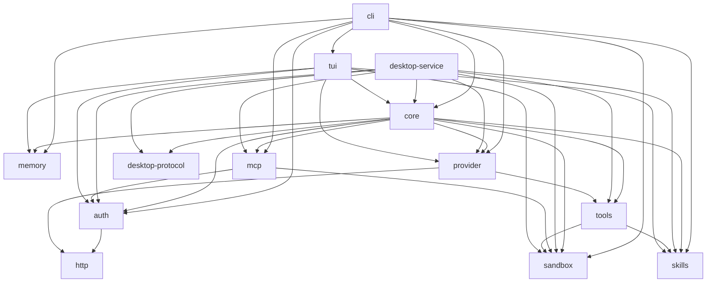

# アーキテクチャ

This is a generated file. Do not edit it by hand. `crates/polaris-core/tests/architecture.rs`が実際のsourceから作り直し、この文書と突き合わせる。ずれたら試験が落ちる。更新するには:

```
UPDATE_ARCHITECTURE=1 cargo test -p polaris-core --test architecture
```

この文書は2つを載せる。crateの依存関係と、外部との接続点である。要求の組み立て順は`docs/context-efficiency.md`、fileごとの一覧は`docs/filemap.md`にある。

## crateの依存



crate 13件、依存 37件。名前の`polaris-`は省いた。開発用の依存は、製品の組み立てを表さないため含めない。

## 外部との接続点

列挙するのは、外部へデータが出るか、processが動くか、利用者の木が変わる箇所である。試験とexampleは除く。境界そのものを実装しているfileは、呼び出し側を埋もれさせないため一度だけ名前を挙げる。

### モデルへの送信

外部へデータが出る。費用が発生する。

実装: `crates/polaris-provider/src/lib.rs`、`crates/polaris-provider/src/openai.rs`、`crates/polaris-provider/src/codex.rs`、`crates/polaris-provider/src/role.rs`、`crates/polaris-provider/src/local_inference.rs`

呼び出し側 13件。

- `crates/polaris-core/src/agent.rs:1115`
- `crates/polaris-core/src/agent.rs:1118`
- `crates/polaris-core/src/agent/skill_catalog.rs:45`
- `crates/polaris-core/src/compaction.rs:241`
- `crates/polaris-core/src/local_execution.rs:153`
- `crates/polaris-core/src/mcp/preselection.rs:346`
- `crates/polaris-core/src/strict_provider.rs:76`
- `crates/polaris-core/src/tier.rs:107`
- `crates/polaris-core/src/tier.rs:110`
- `crates/polaris-core/src/tier.rs:115`
- `crates/polaris-core/src/tier.rs:118`
- `crates/polaris-core/src/tier.rs:125`
- `crates/polaris-core/src/tier/chat.rs:62`

### HTTP

外部へ要求が出る。

実装: `crates/polaris-http/src/lib.rs`

呼び出し側 24件。

- `crates/polaris-auth/src/quota/usage.rs:126`
- `crates/polaris-auth/src/quota/usage.rs:130`
- `crates/polaris-auth/src/token.rs:216`
- `crates/polaris-cli/src/memory.rs:106`
- `crates/polaris-cli/src/memory.rs:108`
- `crates/polaris-provider/src/codex.rs:547`
- `crates/polaris-provider/src/codex.rs:939`
- `crates/polaris-provider/src/codex.rs:943`
- `crates/polaris-provider/src/codex_metrics.rs:139`
- `crates/polaris-provider/src/decision/jev.rs:30`
- `crates/polaris-provider/src/decision/jev.rs:62`
- `crates/polaris-provider/src/decision/jev.rs:65`
- `crates/polaris-provider/src/lib.rs:103`
- `crates/polaris-provider/src/lib.rs:599`
- `crates/polaris-provider/src/local.rs:6`
- `crates/polaris-provider/src/local.rs:254`
- `crates/polaris-provider/src/local.rs:465`
- `crates/polaris-provider/src/openai.rs:61`
- `crates/polaris-provider/src/openai.rs:119`
- `crates/polaris-provider/src/openai.rs:121`
- `crates/polaris-provider/src/turn_affinity.rs:8`
- `crates/polaris-tui/src/tool_memory.rs:711`
- `crates/polaris-tui/src/tool_memory.rs:746`
- `crates/polaris-tui/src/tool_memory.rs:748`

### 隔離実行

processが動く。

実装: `crates/polaris-sandbox/src/lib.rs`、`crates/polaris-sandbox/src/controlled.rs`

呼び出し側 19件。

- `crates/polaris-cli/src/main.rs:1036`
- `crates/polaris-cli/src/main.rs:1069`
- `crates/polaris-cli/src/main.rs:1072`
- `crates/polaris-cli/src/main.rs:2091`
- `crates/polaris-cli/src/main.rs:2101`
- `crates/polaris-core/src/desktop_execution.rs:5`
- `crates/polaris-core/src/execution_owner.rs:674`
- `crates/polaris-sandbox/src/broker.rs:476`
- `crates/polaris-sandbox/src/child_fds.rs:241`
- `crates/polaris-sandbox/src/child_fds.rs:253`
- `crates/polaris-sandbox/src/child_fds.rs:340`
- `crates/polaris-sandbox/src/child_fds.rs:353`
- `crates/polaris-sandbox/src/confine.rs:64`
- `crates/polaris-sandbox/src/confine.rs:71`
- `crates/polaris-sandbox/src/confine.rs:77`
- `crates/polaris-tools/src/bash.rs:9`
- `crates/polaris-tools/src/bash.rs:18`
- `crates/polaris-tools/src/write.rs:10`
- `crates/polaris-tools/src/write.rs:40`

### process起動

残留・port占有・回収漏れ。

呼び出し側 19件。

- `crates/polaris-cli/src/decided.rs:103`
- `crates/polaris-core/src/llama_server.rs:112`
- `crates/polaris-auth/src/login.rs:133`
- `crates/polaris-cli/src/account.rs:174`
- `crates/polaris-core/src/conversation_memory/strict_history.rs:1083`
- `crates/polaris-core/src/mcp/setup/launcher.rs:385`
- `crates/polaris-core/src/mcp/setup/launcher.rs:489`
- `crates/polaris-core/src/project_git.rs:52`
- `crates/polaris-core/src/sync/repository.rs:50`
- `crates/polaris-sandbox/src/child_fds.rs:217`
- `crates/polaris-sandbox/src/child_fds.rs:316`
- `crates/polaris-sandbox/src/child_fds.rs:383`
- `crates/polaris-sandbox/src/child_fds.rs:437`
- `crates/polaris-sandbox/src/child_fds.rs:452`
- `crates/polaris-sandbox/src/child_fds.rs:466`
- `crates/polaris-sandbox/src/child_fds.rs:496`
- `crates/polaris-sandbox/src/confine.rs:197`
- `crates/polaris-sandbox/src/confine.rs:248`
- `crates/polaris-tui/src/lib.rs:3287`

### gitの呼出し

利用者のrepositoryが変わる。

呼び出し側 11件。

- `crates/polaris-cli/src/handoff.rs:8`
- `crates/polaris-cli/src/handoff.rs:46`
- `crates/polaris-cli/src/handoff.rs:72`
- `crates/polaris-cli/src/setting.rs:193`
- `crates/polaris-core/src/project_git.rs:42`
- `crates/polaris-core/src/recipe/git.rs:9`
- `crates/polaris-core/src/recipe/git.rs:72`
- `crates/polaris-core/src/sync/repository.rs:49`
- `crates/polaris-core/src/sync/repository.rs:50`
- `crates/polaris-desktop-service/src/workspace_view.rs:467`
- `crates/polaris-tui/src/lib.rs:3287`
