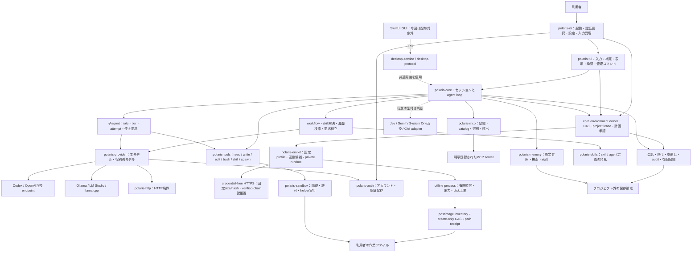
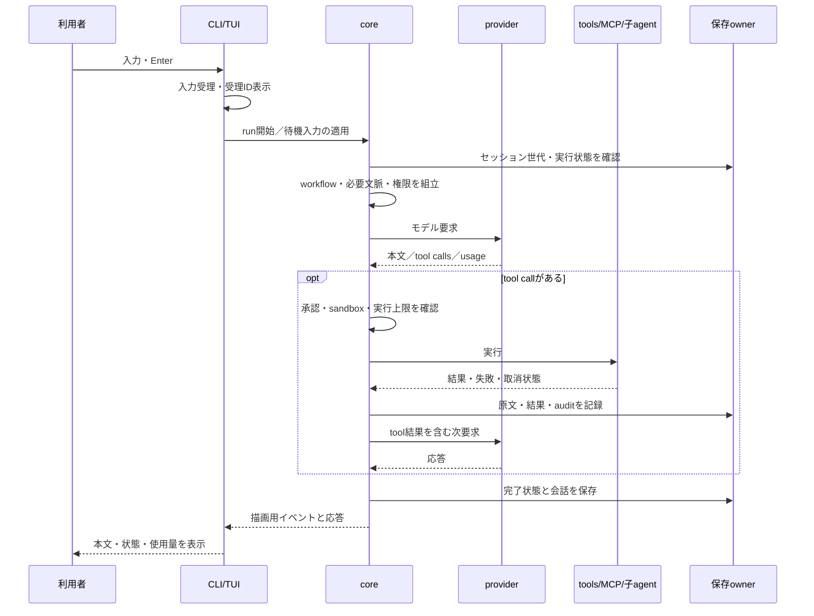

# システム構成図

Polarisの現行ソースを、利用者の入力から実行・保存までの流れで整理する。v1.0.0-rcの配布対象はmacOS arm64のTUIである。GUIと他OSのソースは保持するが、この配布の受入対象には含めない。

## 全体構成

矢印は要求・データの流れを表し、すべてが別processという意味ではない。crate間の正確な依存と外部接続箇所は、ソースから生成する[アーキテクチャ一覧](architecture.md)を参照。

## 1回の入力から応答まで

中断や通信失敗で外部結果が不明な場合は、その状態を表示する。停止要求の受付や`outcome_unknown`を、安全な停止・外部操作の取消完了とは扱わない。

## コンポーネントと実装箇所

| 機能 | 主な実装 | 役割 |
| --- | --- | --- |
| 起動とprovider準備 | `crates/polaris-cli/src/main.rs`、`provider_startup.rs` | 引数・環境設定、認証選択、local serverの寿命、TUI起動 |
| TUI | `crates/polaris-tui/src/lib.rs`、`slash.rs` | 入力編集・補完、working表示、管理コマンド、確認画面 |
| agentと文脈 | `crates/polaris-core/src/agent.rs`、`prompt.rs`、`workflow.rs` | モデルとtoolの往復、段階・skill・履歴の組立 |
| 環境構築 | `crates/polaris-core/src/environment/`、`crates/polaris-envkit/` | CLI/TUI/tool共通の計画・固定取得・offline実行・非上書きpublish・照合復旧 |
| モデル接続 | `crates/polaris-provider/src/`、`crates/polaris-http/src/` | Codex・OpenAI互換・ローカル推論、通信とusage |
| 認証と保存 | `crates/polaris-auth/src/`、coreの`session*`・`desktop_store/` | アカウント、会話・世代・保存結果の照合 |
| toolと隔離 | `crates/polaris-tools/src/`、`crates/polaris-sandbox/src/` | ファイル・shell操作、実行helper、承認境界 |
| MCP | `crates/polaris-mcp/src/`、coreの`mcp/` | stdio/HTTP接続、catalog、候補選別、結果保持 |
| skillと子agent | `crates/polaris-skills/src/`、coreの`spawn.rs`・`tier/` | 定義発見、role/tier、子実行の管理 |
| 原文と検索 | `crates/polaris-memory/src/`、coreの`conversation_memory/` | 原文参照、検索・索引、任意のembedding接続 |
| 任意判断器 | coreの`decision_bands.rs`・`clef.rs`・`managed_decision.rs` | backendの明示選択、回答検証、容量判定、管理generation |
| GUI経路 | `apps/macos/`、`polaris-desktop-service`、`polaris-desktop-protocol` | 共通coreに接続する別の操作画面。今回の配布対象外 |

## 配布範囲と利用条件

| 項目 | v1.0.0-rcの扱い |
| --- | --- |
| macOS arm64 TUI | 配布対象。`polaris`で起動する |
| CLI管理・一発実行 | 同じ実行物の入口として保持する |
| GUI・Windows・Linux | ソースを保持し、今回の配布・実機受入の対象から除外する |
| 主モデル | 利用者が認証またはlocal endpointを設定する。モデルweightsは同梱しない |
| MCP | 登録・許可が必要。すべての外部serverの動作確認を意味しない |
| Jev/SemIf/System One互換 | 任意設定を保持。導入だけで有効化・自動転送しない |
| Clef/Clef-flash | adapterと管理経路はあるが、本番受入profileは0件。通常利用は未提供 |
| strict履歴・embedding | 資源・設定と個別条件が必要。既定の通常会話と区別する |

型付き判断と生成モデルの仲裁は別の経路である。明示的なlocal-onlyは補助判断のremote送信を抑止する。主会話の接続許可やMCPの許可を、この設定で変更するものではない。

詳しい操作は[コマンド参照](command-reference.md)、利用条件は[利用ガイド](usage.md)、公開範囲と検証結果は[v1.0.0-rcリリース資料](releases/v1.0.0.md)を参照。
